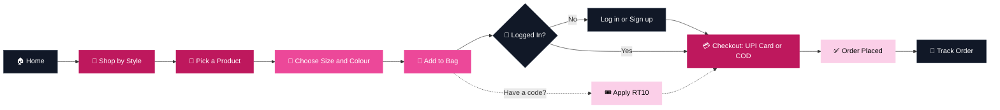

<table width="100%" align="center">
  <tr>
    <td width="20%" align="center" valign="middle">
      
    </td>
    <td width="60%" align="center" valign="middle">
      
    </td>
    <td width="20%" align="center" valign="middle">
      
    </td>
  </tr>
</table>

<div align="center">

<h3>Pick Your Size. Pick Your Colour. Wear It Tomorrow.</h3>


<br/>

<a href="https://shahrishabh1513-jsk.github.io/RT_Fashion-World/"></a>
<a href="https://shahrishabh1513-jsk.github.io/RT_Fashion-World/products.html"></a>
<a href="https://github.com/shahrishabh1513-jsk/RT_Fashion-World"></a>
<a href="https://github.com/shahrishabh1513-jsk/RT_Fashion-World/stargazers"></a>

<br/>


<br/>


</div>

<br/>

<div align="center">

[](#-live-preview)
[](#-about-the-project)
[](#-key-features)
[](#-site-pages)
[](#-user-workflow)
[](#-tech-stack)
[](#-folder-structure)
[](#-getting-started)
[](#-connect)

</div>

<div align="center"></div>

## 🔍 Live Preview

<div align="center">

<table width="90%">
<tr>
<td>🔴 🟡 🟢 &nbsp;&nbsp; <code>shahrishabh1513-jsk.github.io/RT_Fashion-World</code></td>
</tr>
<tr>
<td align="center">
<a href="https://shahrishabh1513-jsk.github.io/RT_Fashion-World/" target="_blank">

</a>
</td>
</tr>
</table>

<br/>

<table width="90%">
<tr>
<td align="center" width="50%">
<b>🛍️ Shop</b><br/><br/>
<a href="https://shahrishabh1513-jsk.github.io/RT_Fashion-World/products.html" target="_blank">

</a>
</td>
<td align="center" width="50%">
<b>ℹ️ About Us</b><br/><br/>
<a href="https://shahrishabh1513-jsk.github.io/RT_Fashion-World/about.html" target="_blank">

</a>
</td>
</tr>
</table>
<br/>

<a href="https://shahrishabh1513-jsk.github.io/RT_Fashion-World/" target="_blank"></a>

</div>

<div align="center"></div>

## 📖 About The Project

<table>
<tr>
<td width="60%" valign="top">

**RT_Fashion World** is a fully responsive **fashion e-commerce website** built around a fresh "pastel-season" collection for women and men, with bags, shoes and jewelry to match.

It covers the whole shopping journey — browsing by style, filtering by category, saving favourites, managing a bag, signing in, checking out and tracking an order — in a clean pastel visual identity.

It was built to practise **real-world storefront UX**: category-driven browsing, sale and promo-code handling, trust signals (shipping, returns, safe payments, stylist chat) and customer account flows — using only **HTML, CSS and JavaScript**.

</td>
<td width="40%" valign="top">

| At a glance | |
|---|---|
| 🛍️ **Type** | Front-end fashion store |
| 🎨 **Theme** | Pastel-season collection |
| 🏷️ **Promo** | Sale up to 40% + code `RT10` |
| 📦 **Flow** | Shop → Bag → Checkout → Track |
| 🧱 **Stack** | HTML · CSS · JavaScript |

</td>
</tr>
</table>

<div align="center"></div>

## ✨ Key Features

<table>
<tr>
<td width="50%" valign="top" align="center">


<div align="left">

- 🧭 **Shop by style** — six departments, one wardrobe
- 🔥 **Trending this week** swipeable carousel
- 🏷️ **Mid-season sale** page with up to 40% off
- 🎟️ Promo code **`RT10`** — 10% off your bag

</div>

</td>
<td width="50%" valign="top" align="center">


<div align="left">

- 🔐 **Log in** and **Sign up** pages
- 👜 **Bag** with live item counter
- 💖 **Saved** items list
- 📦 **My orders** and 🚚 **Track order** pages

</div>

</td>
</tr>
<tr>
<td width="50%" valign="top" align="center">


<div align="left">

- 🚚 **Free shipping** on orders over ₹1,999
- ↩️ **15-day returns** with free size exchange
- 🔒 **Safe payments** — UPI, cards & COD
- 💬 **24/7 help** — chat with a stylist

</div>

</td>
<td width="50%" valign="top" align="center">


<div align="left">

- ⭐ **Customer testimonials** section
- 📬 Newsletter — **₹200 off** your first order
- 🔍 Search overlay, closes with `Esc`
- 📱 Fully **responsive** pastel visual identity

</div>

</td>
</tr>
</table>

<div align="center"></div>

## 📄 Site Pages

<div align="center">

| Page | What's on it | Open |
|:---:|---|:---:|
| 🏠 **Home** | Hero, shop-by-style, trending, sale banner, testimonials & newsletter | [](https://shahrishabh1513-jsk.github.io/RT_Fashion-World/) |
| 🛍️ **Shop** | Product catalog — filter by Women, Men, Footwear or Sale | [](https://shahrishabh1513-jsk.github.io/RT_Fashion-World/products.html) |
| 🔐 **Log in** | Customer sign-in | [](https://shahrishabh1513-jsk.github.io/RT_Fashion-World/login.html) |
| 📝 **Sign up** | New account registration | [](https://shahrishabh1513-jsk.github.io/RT_Fashion-World/signup.html) |
| 👜 **Bag** | Shopping bag with item management | [](https://shahrishabh1513-jsk.github.io/RT_Fashion-World/cartPage.html) |
| 📦 **My orders** | Account & order history | [](https://shahrishabh1513-jsk.github.io/RT_Fashion-World/account.html) |
| 🚚 **Track order** | Order status tracking | [](https://shahrishabh1513-jsk.github.io/RT_Fashion-World/track.html) |
| ℹ️ **About us** | Brand story | [](https://shahrishabh1513-jsk.github.io/RT_Fashion-World/about.html) |
| ✉️ **Contact** | Get in touch with the store | [](https://shahrishabh1513-jsk.github.io/RT_Fashion-World/contact.html) |

</div>

<div align="center"></div>

## 🧭 User Workflow



<div align="center"></div>

## 🧰 Tech Stack

<div align="center">

| Layer | Technology | Purpose |
|:---:|:---:|:---|
| **Markup** |  | Semantic page structure |
| **Styling** |  | Pastel theme, responsive grid & flex layouts |
| **Interactivity** |  | Bag logic, filters, search & carousel |
| **Version Control** |   | Source control |
| **Deployment** |  | Live hosting |

</div>

<div align="center"></div>

## 📂 Folder Structure

<details>
<summary><b>Click to expand the folder structure 📁</b></summary>

```bash
RT_Fashion-World/
│
├── assets/
│   └── rt-fashion-hub-logo.png     # README logo
│
├── images/
│   ├── logo/                          # RT Fashion Hub logo
│   └── products/                        # Product & category images
│
├── index.html                              # Home page
├── products.html                             # Shop / product catalog
├── login.html                                  # Log in page
├── signup.html                                   # Sign up page
├── cartPage.html                                   # Shopping bag
├── account.html                                      # My orders
├── track.html                                          # Order tracking
├── about.html                                            # About us
├── contact.html                                            # Contact
│
├── css/
│   └── style.css                                               # All styles
│
├── js/
│   ├── cart.js                                                     # Bag logic
│   └── main.js                                                         # Shared interactions
│
└── README.md                                                               # Project documentation
```

</details>

<div align="center"></div>

## 🚀 Getting Started

<table width="100%">
<tr>
<td width="40%" valign="top">

**Option 1 — Use the live site**

No setup needed 👉 **[Open RT_Fashion World](https://shahrishabh1513-jsk.github.io/RT_Fashion-World/)**

</td>
<td width="60%" valign="top">

**Option 2 — Run it locally**

```bash
git clone https://github.com/shahrishabh1513-jsk/RT_Fashion-World.git
cd RT_Fashion-World

# open index.html in your browser
# (or use Live Server in VS Code)
```

</td>
</tr>
</table>

✅ No build tools, dependencies, or installations required — it's a pure **HTML/CSS/JS** project.

<div align="center"></div>

## 🎯 Roadmap

<table>
<tr>
<td width="50%" valign="top">

**✅ Done**
- [x] Multi-page storefront (Home, Shop, About, Contact)
- [x] Bag, Log in / Sign up, My orders & Track order pages
- [x] Sale banner with promo-code support
- [x] Testimonials & newsletter sections

</td>
<td width="50%" valign="top">

**🚧 Up next**
- [ ] 🔧 Backend integration for real bag/checkout persistence
- [ ] 💳 Payment gateway integration
- [ ] 🔍 Advanced search & size/colour filters
- [ ] 🌙 Dark mode

</td>
</tr>
</table>

<div align="center"></div>

## 🤝 Connect

<div align="center">

**Rishabh Alpeshabhai Shah**

<a href="https://rishabh-shah-portfolio.netlify.app/"></a>
<a href="https://www.linkedin.com/in/rishabh-alpeshabhai-shah-91b9072a6/"></a>
<a href="mailto:shahrishu1515@gmail.com"></a>
<a href="https://github.com/shahrishabh1513-jsk"></a>

<br/>

### ⭐ If you like this project, give it a star — it helps a lot!


<br/>

**Made with 🛍️ & 💗 by Rishabh Shah**


</div>
